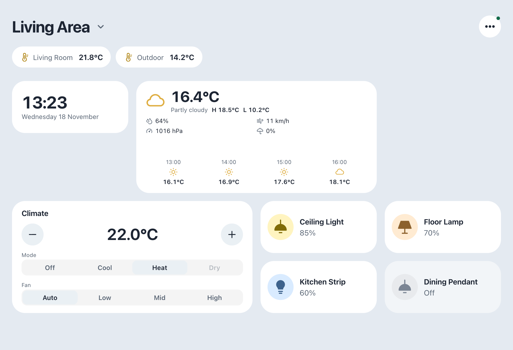
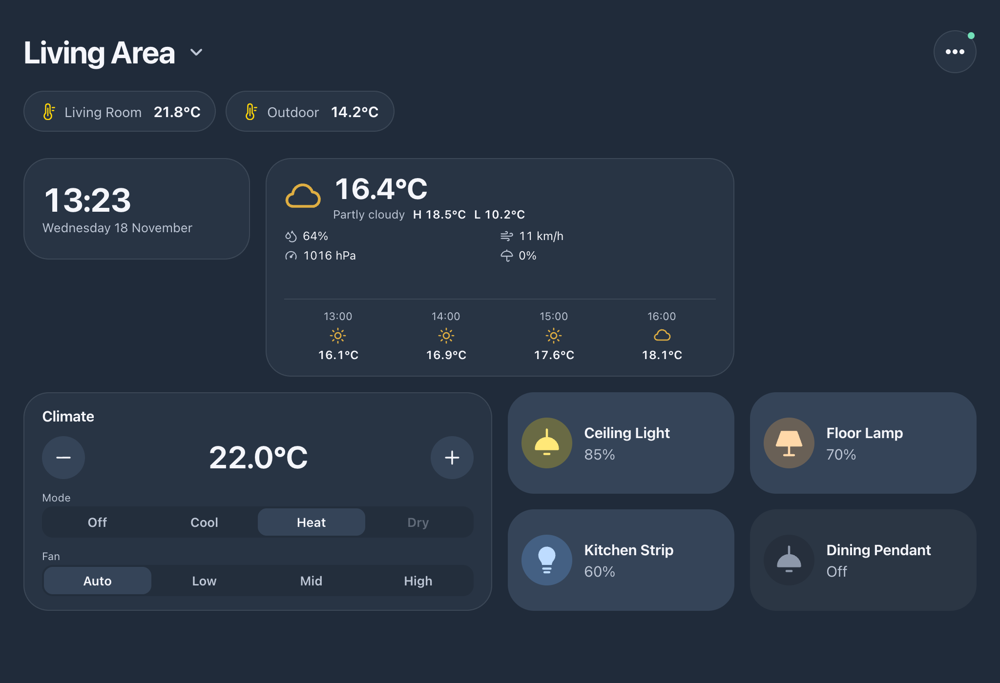
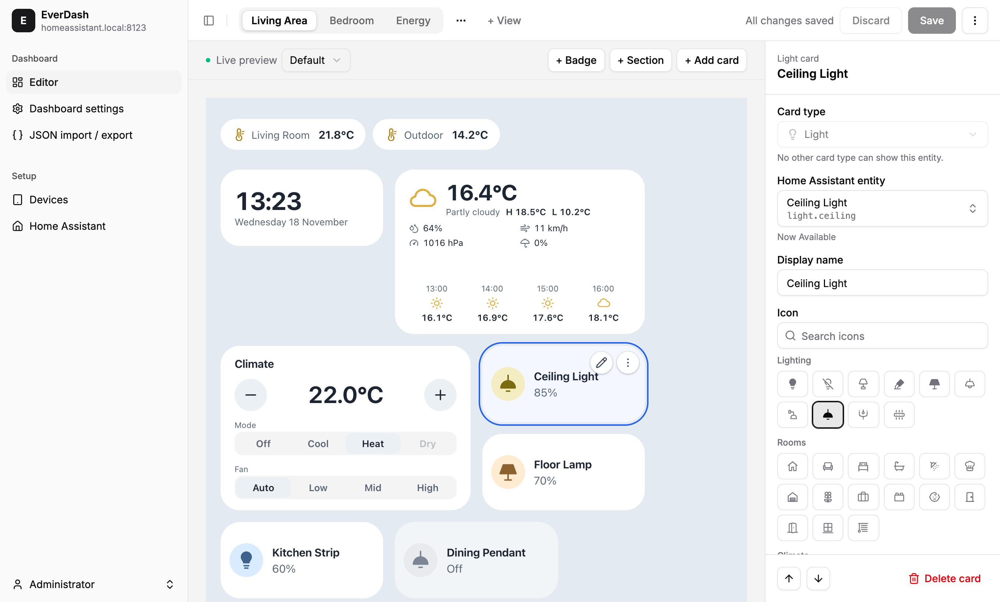

# EverDash

[](https://github.com/beniaminrychter/everdash/releases/latest)  [](https://github.com/beniaminrychter/everdash/actions/workflows/checks.yml) [](https://buymeacoffee.com/beniaminryu)

Turn legacy tablets (including iPad on iOS 12 / Safari 12) into fast, clean Home Assistant dashboards with a visual drag-and-drop builder.


## Screenshots

| Tablet dashboard (Light) | Tablet dashboard (Dark) |
| :-: | :-: |
|  |  |

**Visual dashboard builder**



## Installation

### Option 1: Home Assistant App (Home Assistant OS / Supervised)

Click the button below to add the EverDash repository to your Home Assistant instance:

[](https://my.home-assistant.io/redirect/supervisor_add_addon_repository/?repository_url=https%3A%2F%2Fgithub.com%2Fbeniaminrychter%2Feverdash)

<details>
<summary>Or add the repository manually</summary>

1. In Home Assistant, open **Settings → Apps → Install app** (App Store).
2. Open the **⋮** menu in the top-right corner and choose **Repositories**.
3. Paste `https://github.com/beniaminrychter/everdash` and click **Add**.

</details>

1. Find **EverDash** in the App Store, click **Install**, and **Start** the app.
2. Click **Open Web UI** (or open `http://YOUR-HA-HOST:8095/admin/`).
3. Continue to [First-time setup](#first-time-setup).

### Option 2: Docker (standalone)

Run EverDash alongside an existing Home Assistant instance (`linux/amd64` and `linux/arm64`):

```sh
curl -O https://raw.githubusercontent.com/beniaminrychter/everdash/main/compose.published.yaml
export EVERDASH_IMAGE=ghcr.io/beniaminrychter/everdash:0.2.5
docker compose -f compose.published.yaml up -d
```

Or run directly with `docker run`:

```sh
docker run -d \
  --name everdash \
  --restart unless-stopped \
  -p 8095:8095 \
  -v everdash-data:/data \
  ghcr.io/beniaminrychter/everdash:0.2.5
```

To upgrade later, update the version tag and run:

```sh
docker compose -f compose.published.yaml pull
docker compose -f compose.published.yaml up -d
```

<details>
<summary>Option 3: Build from source with Docker Compose (includes Home Assistant)</summary>

```sh
git clone https://github.com/beniaminrychter/everdash.git
cd everdash
docker compose up -d --build
```

This starts Home Assistant on port `8123` and EverDash on port `8095`. Complete Home Assistant onboarding at `http://YOUR-SERVER:8123/`, then open `http://YOUR-SERVER:8095/admin/` and sign in with your Home Assistant LAN URL (`http://YOUR-SERVER-LAN-IP:8123`).

</details>

## First-time setup

1. Open `http://YOUR-SERVER:8095/admin/` in your browser.
2. Select your discovered Home Assistant instance or enter its URL (for example `http://homeassistant.local:8123` or `http://YOUR-HA-IP:8123`), then sign in with a Home Assistant administrator account.
3. Build your views and cards in the **Editor**, then click **Save**.
4. Open **Devices** in the sidebar to view the dashboard URL (`http://YOUR-SERVER:8095/`), QR code, and one-time 6-digit registration code.
5. Open `http://YOUR-SERVER:8095/` on your tablet and enter the registration code.
6. On an iPad, tap **Share → Add to Home Screen** in Safari to launch EverDash full-screen.

<details>
<summary>Resetting the Home Assistant connection</summary>

If your Home Assistant URL changes and you can no longer sign in, reset the saved connection from the container shell:

```sh
docker compose exec everdash node /app/dist-server/server.js --reset-connection
```

</details>
